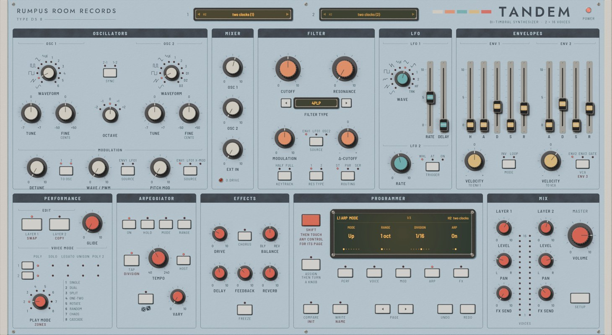

# Tandem

A two-layer synthesizer by Rumpus Room Records for Logic, worked out from the owner's
manual of a modern bi-timbral hybrid synth (two independent 4-voice modules, super
oscillators, a dual-core stereo filter and a binaural signal path). One baby-blue
powder-coated panel with navy screen printing, black knobs with a coloured cap for
each section, push keys with lamps, and an amber display. At 100% it is 1460 × 800
points, so it fits a 14-inch MacBook's screen beside Logic's own window frame.

## Playing it

- **A sound on each layer.** The two windows at the top name the patch on each layer.
  Click a name for the list (by kind: basses, leads, pads, keys, plucks, arps, effects,
  yours; or either layer of a two-layer sound) and choose what goes on that layer; the
  arrows at each end, or scrolling over it, step through them. Any patch can go on
  either layer: a bass on layer 1, a pad on layer 2, then PLAY MODE decides how they
  share the keys. A `*` means that layer has been changed since it was chosen.
- **Two layers.** LAYER 1 and LAYER 2 choose which layer the panel edits: the top row,
  the arpeggiator, DICE and VARY, the effects and the display's pages (their title says
  L1 or L2). Each layer keeps its own voice mode row, voice lamps and mixer column, live
  whichever you edit. SHIFT + LAYER 1 swaps the layers; SHIFT + LAYER 2 copies the one
  you are editing onto the other.
- **Top row:** the sound of the layer you are editing (oscillators, mixer, filter,
  LFOs, envelopes). **Bottom row:** playing and programming.
- **Knobs and faders:** drag (Shift for fine), scroll, double-click for the default.
  While you turn one, a small tag beside it shows its value.
- **Keys with lamps** (sync, sources, keytrack, routing and so on): click the key to
  step through the settings, or click a lamp (or its word) to go straight to it. **Lamp
  rings** (waveforms, octave): click a lamp, click the knob to step, or drag.
- **Right-click** any control for its menu: its page, back to its default, set it to,
  and for knobs the matrix can move, *Modulate from* and *Clear its modulation*.
- **Your own waves.** Right-click a waveform ring (OSC 1, OSC 2 or LFO 1), or a wave
  slot on the VOICE pages, and choose *Import a wave into this slot...*: a WAV, AIFF or
  FLAC of one cycle (up to 8192 points; a wavetable of 2048-point frames gives its
  first). Tandem centres it, scales it to full level and band-limits it like its own
  waves. Eight of yours (U1-U8) sit after Tandem's 32 in every slot's list, by name.
  They are kept with the Logic session, and a patch or performance you write carries
  the waves it uses, so it plays the same on another Mac. Loading one never overwrites
  a wave the other layer is using: the new one takes the next free slot.
- **The matrix at a glance** (the MOD menu's first page): drag a line, or scroll over
  it, to change its amount; click it for its slot's page; right-click it to zero or
  flip the amount, copy the slot to the other layer, or clear it.
- **Undo and redo:** the UNDO and REDO keys, or Cmd-Z and Shift-Cmd-Z.
- **Keyboard and VoiceOver:** Tab moves through the controls in panel order (an amber
  outline shows where you are); the arrow keys change the one in focus, Shift for fine,
  Space presses a key, Delete returns it to its default. VoiceOver reads each control's
  name and value.
- **PLAY MODE** decides how the layers share the keys: 1 SINGLE (the layer you are
  editing), 2 DUAL (both), 3 SPLIT (layer 2 below the split point, layer 1 from it),
  4 ONE-TWO (the first key on layer 1, keys played with it on layer 2), 5 ROTATE (each
  note the other layer), 6 RANDOM (at the odds on the RNDMZR LAYERS page), 7 CHAOS
  (random, with fifths and octaves thrown in at the chances on the RNDMZR!? page) and
  8 CASCADE (layer 1 is layer 2's oscillator: it plays into layer 2's filter at layer 2's
  EXT IN level, and is heard only through it). SHIFT + PLAY MODE opens ZONES, and the
  next key you play becomes the split point. KEY RANGES gives each layer a lowest and
  highest key, in every mode; a layer set to its own MIDI channel takes that channel's
  notes whatever the mode.
- **The arpeggiators:** each layer has its own. ON, HOLD (the arpeggio plays on after
  you let go, until the next chord; with the arpeggiator off it holds the notes), MODE
  (up, down, up + down, up & down, random, as played, chord) and RANGE (one to four
  octaves); the ARP pages add the division (1/1 to 1/32, and triplets), swing and gate.
  Both run on one clock: with HOST lit, Logic's tempo, and its beat while it plays, so
  arpeggios land on the bar; otherwise TEMPO, or TAP (tapping takes the clock from
  Logic). TAP's lamp flashes on the beat; ON's beats while its arpeggio plays.
- **The side chain (EXT IN)** is built but switched off in this build: giving Tandem an
  input bus left it silent in Logic, so the plugin has none for now (`-DTD_SIDECHAIN=ON`
  builds it with one). With it, layer 1's EXT IN knob feeds the side chain into its
  filter; the envelope follower (SHIFT + EXT IN: attack, release, threshold, gain) is a
  matrix source on both layers, and with the VCA on GATE it opens and closes the VCA.
  Layer 2's EXT IN knob is CASCADE's level, and works.
- **The display** shows the page chosen with PERF, VOICE, MOD, ARP or FX (press again,
  or use the PAGE arrows, for the next page; click the title for a list of the pages).
  Drag a column up or down, or scroll over it, to change that value; click a list to
  step it. Touch any control and it shows its value.
- **SHIFT:** click it, then touch a control, to open that control's page (SHIFT +
  CUTOFF: the filter routing, type, resonance type and keytrack; SHIFT + VCA: envelope
  3). The red legends are SHIFT's own jobs: SWAP and COPY on the layer keys, ZONES on
  PLAY MODE, DIVISION on TAP, INIT on COMPARE (a blank patch), NAME on WRITE.
- **The mod matrix** opens on an overview of every slot in use (click one to open it),
  then has twelve slots, one per MOD page: SOURCE, DEST, AMOUNT, and VIA (a
  second source that scales the amount: put the mod wheel there and it brings the
  modulation in). SHIFT turns the AMOUNT column into the slot's curve: linear, exp,
  steps (twelfths: semitones on pitch) or smooth. **ASSIGN** is the quick way in: click
  it, then turn the knob you want to modulate; a free slot opens with that knob as the
  destination, LFO 1 as the source, and the amount following your turn.
- **Modulated knobs** carry a small amber dot at the foot of their scale. While you touch
  one, or while ASSIGN is lit, an arc over the scale shows how far the matrix can move it,
  and a moving tick shows where it is now.
- **NOTE RND** is a matrix source: a new random value for every note, or (NOTE RANDOM
  page) a cycle of 1 to 8 values that starts again after a second's pause.
- **VOICE MODE** (in PERFORMANCE): a key per layer steps poly, solo, legato, unison and
  poly 2; the lamps show each layer's mode, and you can click a lamp. The **voice lamps**
  in MIX light while each voice sounds, brighter as it plays louder.
- **DICE and VARY** (in the arpeggiator box): DICE rolls a pattern of small differences
  (velocity, envelope times, brightness; past 7 on VARY, the odd octave) that steps on
  with each note; VARY sets how much you hear, from none at 0. The roll is saved with the
  patch, and a second's pause starts the pattern again, so a phrase varies the same way
  each time.
- **Sounds:** 48 one-layer patches (basses, leads, pads, keys, plucks, effects) and 16
  two-layer performances that show off the play modes and arpeggiators. Click the name
  on the right of the display's top line for whole sounds. WRITE saves one layer as a
  patch (to put on either layer later) or both layers as a performance, in Music /
  Rumpus Room Records / Tandem / Presets; its lamp blinks when something has changed.
  COMPARE flips between the sound as edited and as it was chosen.
- **SETUP** slides a drawer up over the bottom row: master tune, transpose, velocity and
  pressure response, MIDI channel per layer, sustain pedal polarity, AGE (how much
  every patch drifts) and the panel's size.
- Hover over anything for a note on what it does.

## Where the build is

| Stage | What | State |
| --- | --- | --- |
| 1 | One complete layer: oscillators, filter, LFO 1, envelopes, voice modes, the twelve-slot matrix with VIA and curves, NOTE RND, DICE and VARY, effects; the window, with ASSIGN, modulation dots and arcs, and voice lamps; presets | done |
| 2 | The second layer (edit, swap, copy), the eight play modes with zones, key ranges and the randomiser, an arpeggiator per layer on a shared clock (host sync, tap tempo), the envelope follower (its side chain input is switched off for now), MIDI channel per layer, 16 two-layer factory sounds | done |
| 3 | A new layout sized for a 14-inch MacBook (bigger print and display, patch windows for each layer, UNDO and REDO keys, the setup drawer over the panel), more detailed faders, a patch on each layer, your own single-cycle waves (eight, kept with the session and with saved sounds), a matrix overview you can edit directly | **this build** |

## Installing

Get `tandem-<version>-mac` from the newest green run on the Actions page, open the disk
image, quit Logic, and in Terminal run:

    bash "$(ls -td /Volumes/tandem*/ | head -1)install.sh"

Then, on a Software Instrument track: AU Instruments > Rumpus Room Records > Tandem.

## The sound engine

Everything below is measured in `tests/engine_tests.cpp`.

**Oscillators.** Each oscillator is a centre oscillator and six sister oscillators
(the super waveform). DETUNE spreads the sisters in pitch (up to 70 cents) and, in
Binaural mode, between the ears. Phases are 32-bit accumulators, as in direct digital
synthesis, so tuning is exact (A4 measures 440.0000 Hz at 44.1, 48 and 96 kHz). Waves
are read from band-limited tables, one per octave, at twice the host rate below 70 kHz.
What would fold over lands above 26 kHz, and a 95-tap halfband filter (108 dB down)
removes it on the way back down. Measured aliasing: saw at C7 -99 dB, square at C7
-102 dB, saw at E7 -98 dB.

Hard sync (2-1 or 1-2) runs the synced saw, square or pulse as its exact shape and
smooths every jump with a 16-tap band-limited step at its exact time: -98 dB. Synced
sines and alternative waves smooth the reset step only: -63 to -90 dB. Cross
modulation is linear FM through zero. WAVE/PWM narrows a pulse or morphs a wave into
the next (sine to saw, saw to square, triangle to saw, an alternative wave to the
next slot). OSC 2's last three positions are drones on C2.

There are 32 alternative waves of Tandem's own (organs, vowels, synced and FM shapes,
folded and clipped sines, and more), and room for eight of yours. The hardware's own
waves are not in its manual, so none of them are copied.

**Filter.** Each voice has two filter cores. Each core is four OTA one-pole stages in a
loop, solved without a unit delay, with a saturating input stage. Low, high and band
pass, all pass and phaser responses of 1 to 4 poles come from mixing the input and
the four stage taps. The routings and their types:

- STEREO (Binaural): one core per ear, 12 types including 1LP+3HP and 3LP+1HP
- PARALLEL: the two cores side by side, 4 types
- SERIES: one into the other (phaser into low pass and so on), 6 types

That makes 22 in all. Δ-CUTOFF pulls the two cores apart. Small-signal responses
match theory: 4-pole low pass -12.04 dB at cutoff, all pass flat within 0.001 dB.

Resonance type 1 feeds back through a 2-pole high pass at a quarter of the cutoff,
so the low end stays full (60 Hz within 2 dB near the top of the resonance). Type 2
loses it, like vintage 4-pole filters (-13 dB). Both self-oscillate in tune: with
KEYTRACK on FULL, within 0.3 cents from C3 to C6.

**Modulation.** LFO 1 has ten shapes, plus HF (20 Hz to 20 kHz) and HF TRK, a third
oscillator that follows the keyboard and can be added into either oscillator's
channel. It runs free, once or reset, with a delayed fade-in, and in Binaural mode a
left/right phase offset. ENV 1 has hold and can invert or loop; ENV 2 drives the VCA;
ENV 3 is on the MOD pages, and the VCA can run from ENV 2, ENV 3 or be held open.
Envelopes are analog RC curves, and a retrigger starts from where the envelope is,
so stolen voices don't click. LFO 2 rides the mod wheel and aftertouch. The matrix
has seven slots, ten sources and fifteen destinations.

**Voices.** POLY 1, POLY 2, SOLO, LEGATO and UNISON (level, detuned, octave, fifth,
major). VOICES sets how many: 4 by default, like each of the hardware's modules.
Binaural mode pairs voices into stereo super voices, so 4 voices make 2. DRIFT gives
each voice its own small pitch, cutoff and envelope offsets plus a slow wander.
Portamento is a time per octave, so small steps are quicker than big leaps.

**Effects.** On the layer: drive (harmonic, overdrive, fuzz; at the internal rate),
chorus and a 3-band equaliser. On FX SEND: a delay locked to Logic's tempo (stereo,
ping-pong, mono; with freeze) and an eight-line reverb.

Cost, one layer at 44.1 kHz with effects on: 4 voices about 8% of one core here;
16 voices with full detune about 45%. A layer with nothing to play, its effects' tails
gone, sleeps and costs nothing, so SINGLE costs what one layer does.

**Play modes and arpeggiators.** Notes go through the play mode to a layer (each key
remembers where it went, so changing the mode or the edited layer while it is held
cannot strand it), then through that layer's arpeggiator. The arpeggiators run on one
beat clock and are sample-accurate: at 120 BPM in sixteenths every step lands within 32
samples of its 6000-sample grid, full swing puts the off steps a third of a step late,
and on Logic's grid a key a little late for a step plays at once while a later one waits
for the next. A loop back in Logic re-grids them without a stall.

**The side chain.** The envelope follower is a peak follower with its own attack and
release (1 ms to 3 s), a threshold and input gain. In CASCADE layer 1's whole output
(its effects included) feeds layer 2's voices through the same path as the EXT IN.

## Layout

- `engine/`: the sound engine, header-only C++17 with no dependencies.
  - `td_dsp.hpp`: helpers, the FFT, the halfband and the band-limited step
  - `td_wave.hpp`: the wave tables and the 32 alternative waves
  - `td_voice.hpp`: envelopes, LFOs, the filter core and the voice
  - `td_layer.hpp`: voice allocation and the layer's signal chain
  - `td_arp.hpp`: the arpeggiator and HOLD
  - `td_fx.hpp`: the effects
  - `td_engine.hpp`: the instrument: the play modes, the clock, the follower
- `plugin/`: the JUCE plugin.
  - `Params.h`: every parameter, and how they become the engine's settings
  - `Presets.h`: the factory presets
  - `PluginProcessor`
  - `PluginEditor`: the window, painted over the rendered panel, with the display's pages
  - `Layout.h` and `HelpText.h`: generated by `art/build_plugin_one.py`
- `tests/`:
  - `engine_tests.cpp`: the engine's measurements
  - `plugin_selftest.cpp`: drives the real processor as a host would
  - `ui_snapshot.cpp`: renders the window to PNGs
- `art/`: the panel pipeline (Blender via `bpy`).
  - `layout_one.py`: the single source of control positions and legends
  - `textures_one.py`: the screen-printing masks (navy, the oxblood SHIFT screen, the stripes, the drawer)
  - `render_one.py`: the panel (powder coat and print), knob strips, lamps; on top of `render.py`'s parts
  - `render_plugin_art.sh`, then `build_plugin_one.py`: the plugin's art and `Layout.h`
  - `render_one.sh`: the mockups (close-ups, display pages, the drawer)
  - `layout.py`, `layout_final.py`, `make_textures.py`: the earlier faceplates
